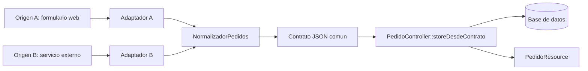

# Práctica 2.3 - Patrones de traducción y normalización

## 1. Identificación del conflicto estructural

Se integran dos orígenes de datos heterogéneos para la creación de pedidos del restaurante.

### Origen A: formulario web / cliente del restaurante

Estructura plana, con nombres en camelCase y tipos flexibles (cadenas):

```json
{
  "clienteId": "1",
  "productoId": "3",
  "cantidad": "2",
  "precioUnitario": "5,50",
  "direccion": "Calle Kennedy",
  "referencia": "Casa blanca",
  "observaciones": "Entrada principal",
  "latitud": "-0.94886",
  "longitud": "-80.63806"
}
```

### Origen B: servicio externo simulado de pedidos

Estructura anidada, con nombres en inglés y tipos mixtos:

```json
{
  "customer": { "id": 1 },
  "item": {
    "product_id": 3,
    "units": 2,
    "unit_price": "5.50"
  },
  "delivery": {
    "address": "Calle Kennedy",
    "reference": "Casa blanca",
    "observations": "Entrada principal",
    "latitude": -0.94886,
    "longitude": -80.63806
  }
}
```

### Diferencias estructurales identificadas

1. **Nombres de campos diferentes**: `clienteId` / `customer.id` frente a `cliente_id`; `productoId` / `item.product_id` frente a `productos[].producto_id`.
2. **Tipos de datos diferentes**: el origen A envía identificadores y cantidades como cadenas, mientras que el origen B y el backend usan enteros.
3. **Formatos monetarios diferentes**: el origen A usa coma decimal (`"5,50"`), el origen B usa punto decimal (`"5.50"`).
4. **Estructura plana frente a anidada**: el origen A es plano; el origen B agrupa cliente, item y entrega en objetos.

## 2. Tabla de mapeo

| Origen A | Origen B | Contrato común | Regla de transformación |
|----------|----------|----------------|--------------------------|
| `clienteId` | `customer.id` | `cliente_id` | Conversión explícita a entero. |
| `productoId` | `item.product_id` | `productos[].producto_id` | Conversión explícita a entero. |
| `cantidad` | `item.units` | `productos[].cantidad` | Conversión explícita a entero; se rechazan decimales. |
| `precioUnitario` | `item.unit_price` | `productos[].precio_unitario` | Se aceptan `.` o `,` como separador decimal; se rechazan separadores de miles y combinaciones ambiguas; se convierte a número. |
| `direccion` | `delivery.address` | `entrega.direccion` | Cadena obligatoria, se recorta. |
| `referencia` | `delivery.reference` | `entrega.referencia` | Cadena opcional. |
| `observaciones` | `delivery.observations` | `entrega.observaciones` | Cadena opcional. |
| `latitud` | `delivery.latitude` | `entrega.latitud` | Conversión explícita a número. |
| `longitud` | `delivery.longitude` | `entrega.longitud` | Conversión explícita a número. |

## 3. Contrato JSON normalizado

El contrato común reutiliza el contrato existente de creación de pedidos del backend:

```json
{
  "cliente_id": 1,
  "productos": [
    {
      "producto_id": 3,
      "cantidad": 2,
      "precio_unitario": 5.5
    }
  ],
  "entrega": {
    "direccion": "Calle Kennedy",
    "referencia": "Casa blanca",
    "observaciones": "Entrada principal",
    "latitud": -0.94886,
    "longitud": -80.63806
  }
}
```

Tipos de datos:

- `cliente_id`: entero.
- `productos`: arreglo con al menos un elemento.
- `productos[].producto_id`: entero.
- `productos[].cantidad`: entero mayor a cero.
- `productos[].precio_unitario`: número (opcional, informativo; el backend usa el precio de catálogo para los cálculos).
- `entrega.direccion`: cadena.
- `entrega.referencia`: cadena o nulo.
- `entrega.observaciones`: cadena o nulo.
- `entrega.latitud`: número entre -90 y 90.
- `entrega.longitud`: número entre -180 y 180.

## 4. Implementación técnica

### Servicio creado

- `app/Services/NormalizadorPedidos.php`

### Métodos implementados

- `normalizarOrigenA(array $datos): array`
- `normalizarOrigenB(array $datos): array`

Métodos privados reutilizados:

- `normalizarProductoOrigenA()`
- `normalizarProductoOrigenB()`
- `normalizarEntregaOrigenA()`
- `normalizarEntregaOrigenB()`
- `obtenerCampo()`
- `obtenerCampoOpcional()`
- `normalizarEntero()`
- `normalizarMonto()`
- `normalizarCoordenada()`
- `normalizarCadena()` y `normalizarCadenaOpcional()`

### Validaciones utilizadas

- Campos obligatorios mediante `ValidationException::withMessages()`.
- Conversión explícita de tipos (enteros, cadenas, números).
- Normalización monetaria con aceptación de `.` o `,`, rechazo de separadores de miles y valores ambiguos.
- Detección de valores ambiguos cuando varias claves equivalentes tienen valores distintos.
- Validación de rangos de coordenadas y de cantidades.

### Integración con el backend

- Se agregaron rutas:
  - `POST /api/v1/pedidos/origen-a`
  - `POST /api/v1/pedidos/origen-b`
- `PedidoController::storeOrigenA()` y `storeOrigenB()` llaman al normalizador y delegan la persistencia en `storeDesdeContrato()`.
- `store()` original se mantiene y ahora reutiliza `storeDesdeContrato()`, evitando duplicar lógica.
- Los datos normalizados se validan nuevamente contra `CrearPedidoRequest` antes de persistir.

### Archivos creados

- `app/Services/NormalizadorPedidos.php`
- `tests/Unit/NormalizadorPedidosTest.php`
- `tests/Feature/NormalizacionApiTest.php`
- `docs/practica-2.3/NORMALIZACION.md`
- `evidencias/practica-2.3/*`

### Archivos modificados

- `app/Http/Controllers/Api/V1/PedidoController.php`
- `routes/api.php`
- `README.md`

## 5. Pruebas

### P1: Entrada válida del origen A

- Entrada: ver `evidencias/practica-2.3/entrada-origen-a.json`.
- Resultado esperado: contrato normalizado con `cliente_id = 1`, `producto_id = 3`, `cantidad = 2`, `precio_unitario = 5.5`.
- Resultado obtenido: igual al esperado.
- Estado: aprobada.

### P2: Entrada equivalente del origen B

- Entrada: ver `evidencias/practica-2.3/entrada-origen-b.json`.
- Resultado esperado: contrato normalizado idéntico a P1.
- Resultado obtenido: idéntico a P1 (mismos tipos y valores).
- Estado: aprobada.

### P3: Entrada inválida

- Entrada: ver `evidencias/practica-2.3/entrada-invalida.json` (falta `clienteId`).
- Resultado esperado: `ValidationException` controlada.
- Resultado obtenido: excepción controlada; endpoint retorna HTTP 422.
- Estado: aprobada.

Pruebas adicionales implementadas:

- Monto ambiguo con dos separadores.
- Cantidad inválida.
- Identificador de producto incorrecto.
- Estructura anidada incompleta.
- Normalización de monto con coma en origen B.
- Compatibilidad del endpoint original.

## 6. Diagrama de componentes



## 7. Justificación arquitectónica

La transformación se implementó en un servicio independiente (`NormalizadorPedidos`) porque:

- Evita duplicar la lógica de normalización en varios controladores.
- Mantiene la capa HTTP delgada: el controlador solo orquesta.
- Facilita las pruebas unitarias sin depender del framework HTTP.
- Permite reutilizar la misma lógica desde rutas, comandos o colas futuras.
- Preserva el contrato público existente y la lógica de persistencia.

## 8. Reflexión individual

- **Problema de integración resuelto**: dos componentes con estructuras JSON heterogéneas (nombres, tipos, formatos monetarios y anidamiento) no podían comunicarse directamente con el backend.
- **Decisión técnica**: implementar un normalizador central que produce el contrato común existente, validando explícitamente campos obligatorios, tipos y montos monetarios, sin conversiones silenciosas.
- **Verificación**: pruebas unitarias (P1, P2, P3 y casos adicionales) y pruebas de integración sobre los endpoints nuevos y el endpoint original; ejecución de `php artisan test`.