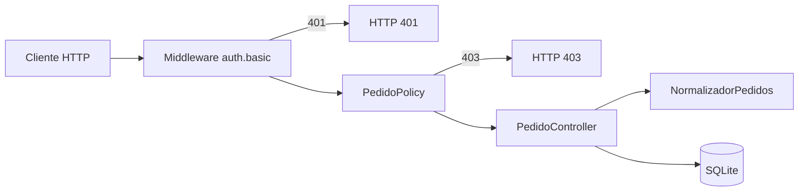

# Práctica 2.4 - Seguridad de la información en tránsito

## 1. Introducción

Los servicios REST expuestos por Estación Burger API transportan datos de pedidos, clientes y estados operativos. Sin controles de autenticación, autorización y protección de credenciales, un cliente malicioso podría consultar pedidos ajenos, modificar estados o extraer información sensible. Esta práctica implementa controles básicos alineados con el Tema 2.4.

## 2. Objetivos

### Objetivo general
Implementar y verificar controles básicos de autenticación, autorización, protección de credenciales y configuración segura en la API REST del restaurante.

### Objetivos específicos
- Proteger los endpoints de gestión de pedidos.
- Permitir acceso solo a usuarios autenticados.
- Restringir la consulta de pedidos al propietario o a un administrador.
- Restringir la modificación de estados a administradores.
- Proteger credenciales mediante variables de entorno.
- Documentar el uso de HTTPS/TLS.
- Verificar los controles con pruebas automatizadas y manuales.

## 3. Descripción del proyecto

- Framework: Laravel 13.
- Lenguaje: PHP 8.3.
- Base de datos: SQLite.
- Autenticación: HTTP Basic mediante middleware nativo `auth.basic`.
- Autorización: Policy `PedidoPolicy`.
- Práctica 2.3 conservada: normalización de orígenes A y B.

## 4. Actividad 1: Identificación de activos y accesos

### Endpoints seleccionados
- `GET /api/v1/pedidos/{id}` (consulta).
- `PATCH /api/v1/pedidos/{id}/estado` (modificación administrativa).
- `POST /api/v1/pedidos` (registro).
- `POST /api/v1/pedidos/origen-a` (registro normalizado).
- `POST /api/v1/pedidos/origen-b` (registro normalizado).

### Roles
- **Público**: sin autenticación.
- **Usuario autenticado**: cuenta vinculada a un cliente.
- **Administrador**: cuenta con rol `admin`.

### Matriz de acceso

| Endpoint | Método HTTP | Público | Usuario autenticado | Administrador |
|----------|-------------|---------|---------------------|---------------|
| `/api/v1/pedidos` | POST | No | Sí (crear) | Sí |
| `/api/v1/pedidos/origen-a` | POST | No | Sí (crear) | Sí |
| `/api/v1/pedidos/origen-b` | POST | No | Sí (crear) | Sí |
| `/api/v1/pedidos/{id}` | GET | No | Sí, solo propio | Sí, cualquiera |
| `/api/v1/pedidos/{id}/estado` | PATCH | No | No | Sí |

### Justificación
- Un usuario autenticado puede crear pedidos y consultar únicamente los asociados a su `cliente_id`.
- Un usuario autenticado no puede consultar pedidos ajenos ni modificar estados.
- Solo el administrador puede modificar el estado de un pedido.

## 5. Actividad 2: Protección de credenciales y configuración

### Variables de entorno relevantes
- `APP_NAME`
- `APP_ENV`
- `APP_KEY`
- `APP_DEBUG`
- `APP_URL`
- `DB_CONNECTION`
- `DB_DATABASE`
- `AUTH_GUARD`

### Medidas implementadas
- Las credenciales no se almacenan en el código fuente.
- `.env` está excluido por `.gitignore`.
- `.env.example` contiene valores ficticios.
- Las contraseñas de usuarios se almacenan hasheadas (`password => hashed`).
- No se registran tokens completos ni contraseñas en respuestas.
- `APP_DEBUG=false` en producción.

### HTTPS/TLS
En producción se debe:
- Utilizar certificados TLS válidos.
- Terminar TLS en el servidor web o proxy inverso.
- Redirigir HTTP a HTTPS.
- Proteger credenciales durante el transporte.
- Configurar cookies y encabezados seguros.

En el entorno local, la aplicación se ejecuta mediante HTTP en `localhost`; ese tráfico no está cifrado mediante TLS. No se afirma que HTTPS esté implementado.

## 6. Actividad 3: Implementación de controles en Laravel

### Mecanismo de autenticación
Se utiliza HTTP Basic mediante `auth.basic`, mecanismo nativo de Laravel, sin agregar dependencias. Las credenciales se envían en el encabezado `Authorization: Basic`.

### Middleware aplicado
Todas las rutas de pedidos están protegidas:
```php
Route::prefix('v1')->middleware('auth.basic')->group(function () { ... });
```

### Autorización
Se implementó `PedidoPolicy`:
- `view`: administrador o propietario del pedido.
- `create`: cualquier usuario autenticado.
- `updateEstado`: solo administrador.

### Restricción por propietario
`Pedido.cliente_id` se compara con `User.cliente_id`. Un usuario no puede consultar ni modificar pedidos ajenos manipulando identificadores.

### Archivos creados
- `app/Policies/PedidoPolicy.php`
- `database/migrations/2026_11_16_230747_add_role_and_cliente_id_to_users_table.php`
- `database/seeders/UserSeeder.php`
- `tests/Feature/SeguridadApiTest.php`
- `docs/practica-2.4/SEGURIDAD.md`
- `evidencias/practica-2.4/*`

### Archivos modificados
- `app/Models/User.php`
- `app/Providers/AppServiceProvider.php`
- `app/Http/Controllers/Controller.php`
- `app/Http/Controllers/Api/V1/PedidoController.php`
- `routes/api.php`
- `database/seeders/DatabaseSeeder.php`
- `bootstrap/app.php`
- `tests/Feature/PedidoApiTest.php`
- `tests/Feature/NormalizacionApiTest.php`

## 7. Actividad 4: Pruebas de seguridad

| Prueba | Condición | Resultado esperado | Resultado obtenido | Estado |
|--------|-----------|--------------------|--------------------|--------|
| P1 | Usuario autenticado con permisos | HTTP 2xx | HTTP 200 | Aprobada |
| P2 | Sin credenciales | HTTP 401 | HTTP 401 | Aprobada |
| P3 | Usuario autenticado sin permisos | HTTP 403 | HTTP 403 | Aprobada |
| P4 | Protección de secretos | .env excluido, sin secretos | Verificado | Aprobada |

Pruebas adicionales:
- Usuario normal no puede modificar estado → HTTP 403.
- Administrador puede modificar estado → HTTP 200.
- Credenciales inválidas → HTTP 401.
- Endpoints de normalización requieren autenticación → HTTP 401.

Total de pruebas automatizadas: **34 aprobadas**.

## 8. Diagrama de componentes



## 9. Reflexión individual

- **Problema resuelto**: los endpoints de pedidos eran públicos y no existía control de acceso ni de propiedad.
- **Decisión técnica**: se usó HTTP Basic nativo y una Policy por propietario/rol, evitando dependencias adicionales y manteniendo el contrato JSON.
- **Verificación**: pruebas automatizadas P1, P2, P3 y P4, más verificación manual con curl.

## 10. Conclusiones

La API ahora exige autenticación en todos los endpoints de pedidos, aplica autorización por propietario y rol, protege credenciales mediante variables de entorno y documenta el uso de TLS. La práctica 2.3 se mantiene funcional bajo las nuevas reglas de acceso.